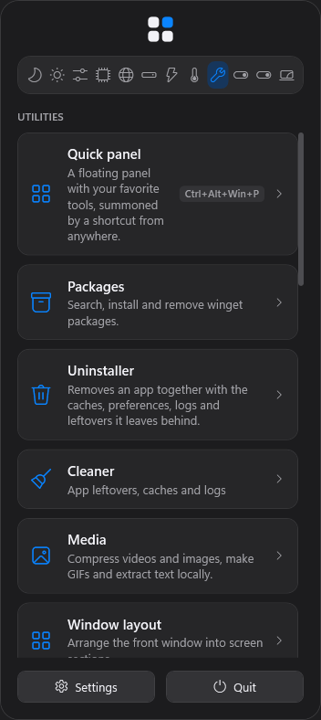
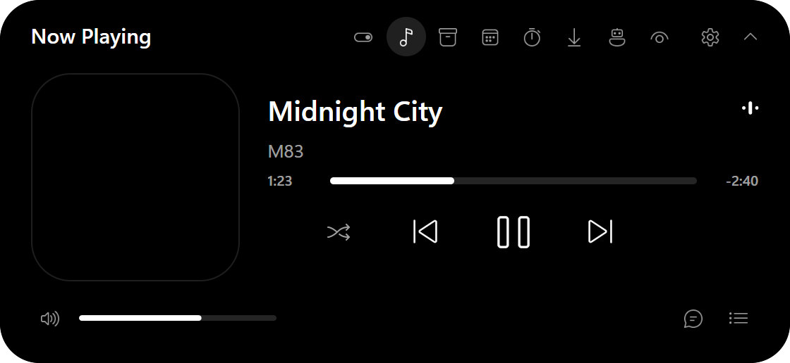

# Fieldkit

One tray icon doing the job of a dozen Windows utilities. Install only what you use.

**[Try the live demo desktop](https://bjdevelopes.github.io/FieldKit/)** · **[Download](https://github.com/BJDevelopes/FieldKit/releases/latest)**

> **On a Mac?** Fieldkit is the Windows counterpart of [Vorssaint](https://github.com/vorssaint/vorssaint-utils),
> the original all-in-one menu bar utility for macOS. Use that instead.

Fieldkit brings the feature set and look of [Vorssaint](https://github.com/vorssaint/vorssaint-utils)
— the all-in-one macOS menu bar utility — to Windows 10 and 11: per-app volume, a real system
monitor, a better app switcher, window layouts, clipboard history, text snippets, a file shelf, an
uninstaller and much more, behind a single notification-area icon. No account, no telemetry, no
subscription.

> **Status: feature-complete preview (0.x).** Every upstream feature is implemented or mapped:
> 22 match the original, 49 are partial (each one says what is missing), 4 are built into Windows
> and 2 cannot be built for an unpackaged Windows app. See [the parity map](docs/PARITY.md).
> Most features have only been verified by tests and rendering so far; expect rough edges until
> they have been used day to day.

<p align="center">
  
  
  
</p>
<p align="center">
  
</p>
<p align="center">
  
</p>

## Download

From [Releases](https://github.com/BJDevelopes/FieldKit/releases), pick one (use `arm64` on ARM PCs):

- **Installer:** `Fieldkit-<version>-setup-x64.exe`. Installs for your account without an administrator
  prompt, adds Fieldkit to the Start menu and to Settings → Apps for uninstalling, and updates in place
  when you run a newer one. Uninstalling turns off "Start with Windows" and keeps your settings.
- **Portable:** `Fieldkit-<version>-win-x64.zip`. Unzip it and run `Fieldkit.exe`, a single self-contained
  file. Keep it somewhere permanent (not Downloads) if you turn on "Start with Windows".

Neither needs .NET installed. Windows SmartScreen may warn about an unsigned app the first time: choose
**More info → Run anyway**.

## Build and run

Requires Windows 10 2004+ and the [.NET 8 SDK](https://dotnet.microsoft.com/download).

```sh
dotnet run --project src/Fieldkit
```

Click the tray icon to open the panel; right-click it for Settings and Quit. A first start installs
the Essentials bundle (volume mixer, system monitor, keep awake, and the Dynamic Island in the taskbar); Settings → Features installs the rest.

`./build.ps1` runs the Release build, all tests and the app's selftest; `./build.ps1 -Publish` also
produces a self-contained single-file `artifacts/win-x64/Fieldkit.exe` (no .NET needed; about 40 MB of memory when idle).

Some features need extras: CPU temperatures and fan control need administrator rights and the
[PawnIO](https://pawnio.eu) driver, recording effects and GIF export need `ffmpeg` on the PATH, and
the package manager and app updates need `winget`.

## Automation

Every action Fieldkit offers can be run from scripts, Stream Deck, AutoHotkey or Task Scheduler:

```sh
Fieldkit.exe --list-actions               # every action id and what it does
Fieldkit.exe --action keepAwake.toggle    # runs it in the running Fieldkit (or starts Fieldkit first)
```

`--action` exits with 0 when the action ran and 1 when it is unknown or its feature is not installed
(use `start /wait` in cmd or `Start-Process -Wait` in PowerShell to read the exit code).

## How it maps to Windows

Every upstream feature is listed in `src/Fieldkit/Core/FeatureCatalog.cs` with its upstream id and
the Windows mechanism used (WASAPI sessions for the mixer, DWM thumbnails for the switcher and
taskbar previews, low-level hooks for mouse and keyboard features, winget in place of Homebrew,
a simulated island at the top of the screen for the Dynamic Island, …). Features that Windows
already provides (F2 rename, cut and paste in Explorer, fixed virtual desktop order) are marked as
built into Windows and point at the system setting.

Fieldkit also has a few extras that Vorssaint does not ship, mostly ideas from its issues and pull
requests: break reminders, duplicate files, disk usage, key remapping, block apps and a browser picker. They start uninstalled;
add them in Settings → Features.

## Privacy

No account, no telemetry, no analytics. Everything stays in `%APPDATA%\Fieldkit`, and the network is
used only by features you invoke (speed test, lyrics, calendar feeds, winget). Details in
[docs/PRIVACY.md](docs/PRIVACY.md).

## Help and contributing

- Something not working? See [troubleshooting](docs/TROUBLESHOOTING.md), then open an
  [issue](https://github.com/BJDevelopes/FieldKit/issues/new/choose).
- Want to help? Read [CONTRIBUTING.md](CONTRIBUTING.md) and [the architecture notes](docs/ARCHITECTURE.md).
  Each feature is a self-contained module under `src/Fieldkit/Features/`.
- Security problems: report them privately, see [SECURITY.md](SECURITY.md).
- What changed: [CHANGELOG.md](CHANGELOG.md).

## License

GPL-3.0-or-later. Fieldkit is an independent Windows project inspired by and feature-mapped from
Vorssaint (also GPL-3.0-or-later). It is not affiliated with or endorsed by the Vorssaint project.
