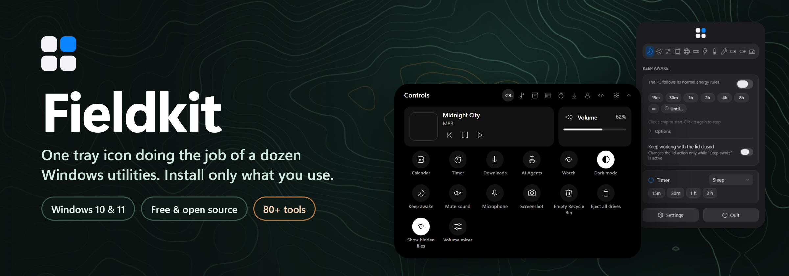
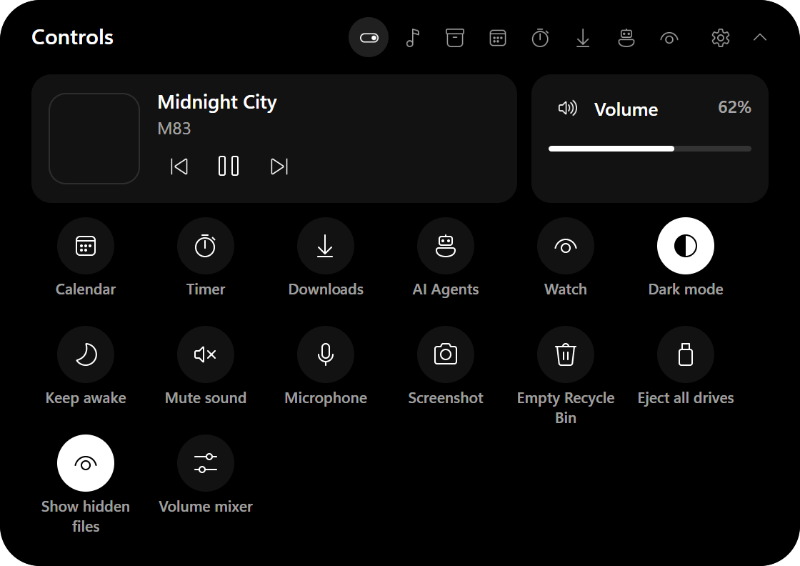
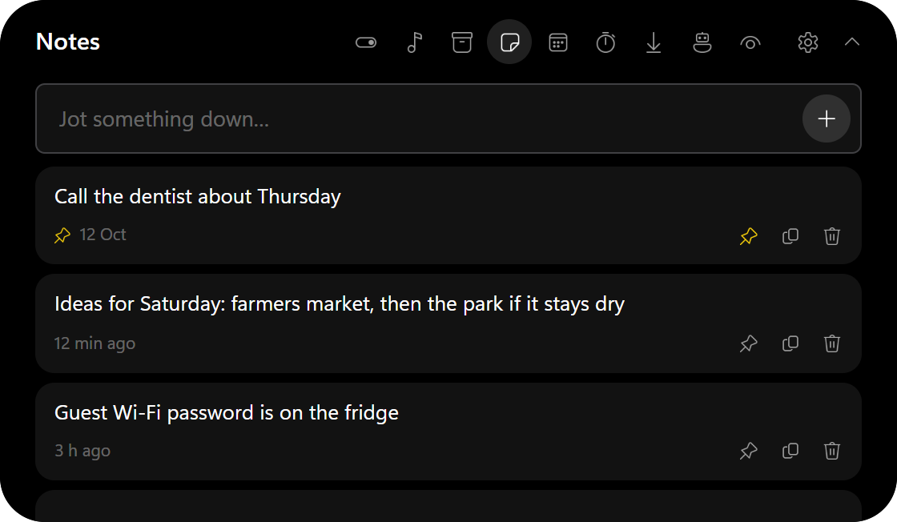
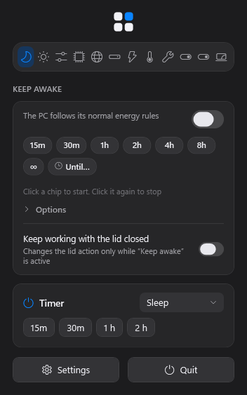
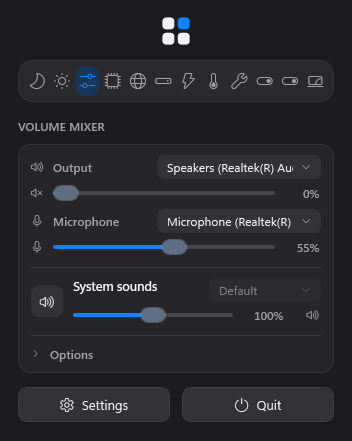
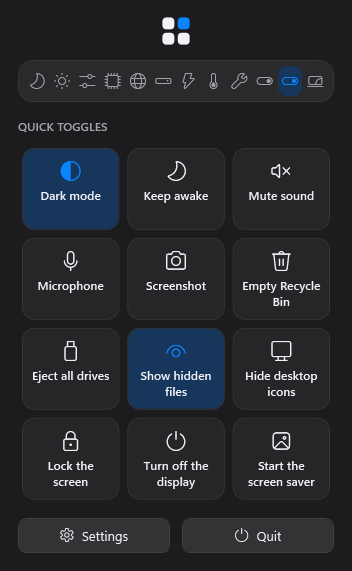
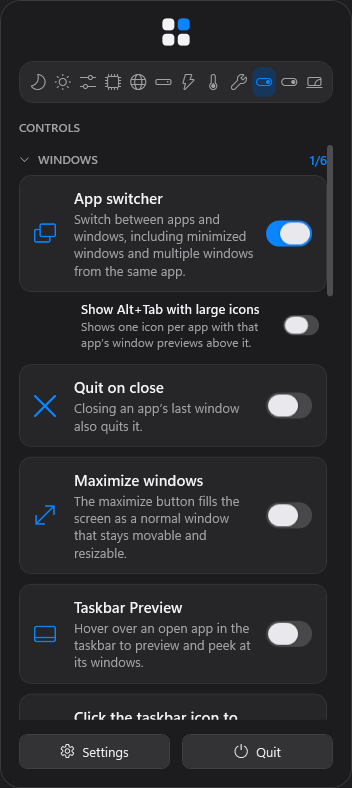
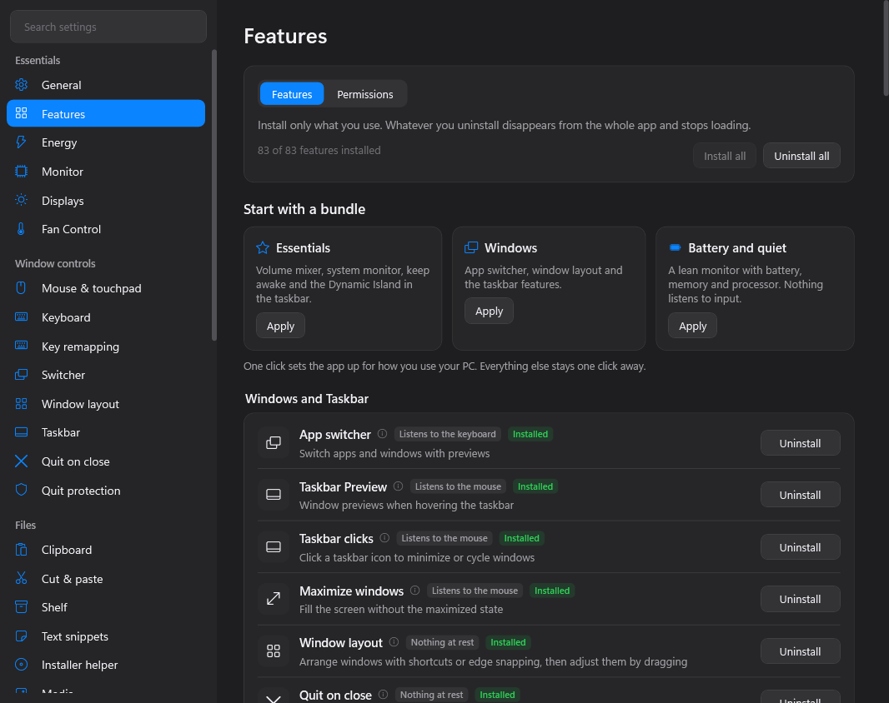

<p align="center">
  
</p>

<p align="center">
  <a href="https://github.com/BJDevelopes/FieldKit/releases/latest"></a>
  <a href="https://github.com/BJDevelopes/FieldKit/actions/workflows/ci.yml"></a>
  <a href="LICENSE"></a>
  
  <a href="https://github.com/BJDevelopes/FieldKit/releases"></a>
  <a href="https://buymeacoffee.com/bjdevelopes"></a>
</p>

<p align="center">
  <b><a href="https://bjdevelopes.github.io/FieldKit/">Live demo</a></b> &nbsp;·&nbsp;
  <b><a href="https://github.com/BJDevelopes/FieldKit/releases/latest">Download</a></b> &nbsp;·&nbsp;
  <a href="docs/README.md">Docs</a> &nbsp;·&nbsp;
  <a href="CHANGELOG.md">Changelog</a> &nbsp;·&nbsp;
  <a href="https://buymeacoffee.com/bjdevelopes">Support</a>
</p>

---

Fieldkit brings the feature set and look of [Vorssaint](https://github.com/vorssaint/vorssaint-utils), the
all-in-one macOS menu bar utility, to **Windows 10 and 11**. Per-app volume, a real system monitor, a better
app switcher, window layouts, clipboard history, text snippets, a file shelf, screenshots, an uninstaller and
dozens more tools, behind a single notification-area icon. No account, no telemetry, no subscription.

> [!TIP]
> **On a Mac?** Use [Vorssaint](https://github.com/vorssaint/vorssaint-utils), the original. Fieldkit is its
> independent Windows counterpart.

> [!NOTE]
> **Status: feature-complete preview (0.x).** Every upstream feature is implemented or mapped: 22 match the
> original, 49 are partial (each one says what is missing), 4 are built into Windows and 2 cannot be built for
> an unpackaged Windows app. See [the parity map](docs/PARITY.md). Most features have been verified by tests and
> rendering so far, so expect rough edges until they have been used day to day.

## What you get

<table>
  <tr>
    <td width="50%" valign="top">
      <h3>🏝️ Dynamic Island in your taskbar</h3>
      Music with lyrics, a timer, downloads, a calendar, a file shelf, AI agent usage and quick controls, opening
      from a pill next to the clock. Put it at the top of the screen instead if you like.
    </td>
    <td width="50%" valign="top">
      <h3>🎚️ Volume mixer and system monitor</h3>
      Per-app volume and output switching, plus CPU, GPU, memory, network, disk and battery readings in the panel
      or the notification area, with alerts when something goes over.
    </td>
  </tr>
  <tr>
    <td valign="top">
      <h3>🪟 Window and taskbar tools</h3>
      An Alt+Tab replacement with live previews, window layouts and edge zones, taskbar previews and click
      actions, quit-on-close, and mouse and keyboard tweaks such as smooth scrolling and key remapping.
    </td>
    <td valign="top">
      <h3>📋 Clipboard, snippets and files</h3>
      Clipboard history that skips password managers, text snippets, a file shelf, a duplicate finder, a disk
      usage map, an uninstaller and a cleaner.
    </td>
  </tr>
  <tr>
    <td valign="top">
      <h3>📸 Capture</h3>
      Screenshots with annotations and scrolling capture, screen recording with an editor, copy text from any part
      of the screen, and a colour picker.
    </td>
    <td valign="top">
      <h3>⚡ Everyday helpers</h3>
      Keep awake (also while AI agents work), quick notes in the island, a command bar and radial menu, break reminders,
      a browser picker, app blocking, quick toggles for dark mode, mute and the screen saver, and meeting links from your calendar.
    </td>
  </tr>
</table>

**Install only what you use.** Everything starts installed; Settings → Features uninstalls what you don't want
(or applies a bundle such as Essentials), and anything you remove disappears from the whole app and stops loading.

## A look around

<table>
  <tr>
    <td align="center" width="50%"><br><sub>Controls</sub></td>
    <td align="center" width="50%"><br><sub>Notes</sub></td>
  </tr>
</table>

<table>
  <tr>
    <td align="center" width="25%"><br><sub>Keep awake</sub></td>
    <td align="center" width="25%"><br><sub>Volume mixer</sub></td>
    <td align="center" width="25%"><br><sub>Quick toggles</sub></td>
    <td align="center" width="25%"><br><sub>Controls</sub></td>
  </tr>
</table>

<p align="center">
  
</p>

Want to click around? The **[live demo](https://bjdevelopes.github.io/FieldKit/)** is the real interface drawn
in your browser: open Settings, install and uninstall features, expand the island.

## Download

From [Releases](https://github.com/BJDevelopes/FieldKit/releases/latest), pick one (use `arm64` on ARM PCs):

| | File | Good for |
|---|---|---|
| 🧩 **Installer** | `Fieldkit-<version>-setup-x64.exe` | Most people. Installs for your account with no administrator prompt, adds a Start menu entry and an uninstaller in Settings → Apps, and updates in place when you run a newer one. Uninstalling turns off "Start with Windows" and keeps your settings. |
| 📦 **Portable** | `Fieldkit-<version>-win-x64.zip` | Unzip and run `Fieldkit.exe`, a single self-contained file. Keep it somewhere permanent (not Downloads) if you turn on "Start with Windows". |

Neither needs .NET installed.

> [!NOTE]
> Windows SmartScreen may warn about an unsigned app the first time: choose **More info → Run anyway**.

Click the tray icon (or the island) to open the panel; right-click the tray icon for Settings and Quit.

### Updating

Fieldkit looks for a newer release a few seconds after it starts and asks: **"Fieldkit 0.5.0 is available. Update now?"**
with what's new, and three choices: *Update now*, *Later* or *Skip this version*. An installed copy then downloads the
new installer, checks it against the SHA-256 checksum GitHub published for that exact file, installs over the old
version and starts again by itself. (The portable copy can't replace the file it runs from, so it opens the download
page instead.) *Settings → About* has **Check for updates** and a switch to turn the start-up check off. The check is one
request to GitHub's public releases list; nothing about you or your PC is sent.

## Build and run

Requires Windows 10 2004+ and the [.NET 8 SDK](https://dotnet.microsoft.com/download).

```sh
dotnet run --project src/Fieldkit
```

`./build.ps1` runs the Release build, all tests and the app's selftest. `./build.ps1 -Publish` also produces a
self-contained single-file `artifacts/win-x64/Fieldkit.exe` (no .NET needed; about 40 MB of memory when idle),
and `./build.ps1 -Installer` builds the installer too (needs [Inno Setup 6](https://jrsoftware.org/isinfo.php)).

Some features need extras: CPU temperatures and fan control need administrator rights and the
[PawnIO](https://pawnio.eu) driver, recording effects and GIF export need `ffmpeg` on the PATH, and the package
manager and app updates need `winget`.

## Automation

Every action Fieldkit offers can be run from scripts, Stream Deck, AutoHotkey or Task Scheduler:

```sh
Fieldkit.exe --list-actions               # every action id and what it does
Fieldkit.exe --action keepAwake.toggle    # runs it in the running Fieldkit (or starts Fieldkit first)
```

`--action` exits with 0 when the action ran and 1 when it is unknown or its feature is not installed
(use `start /wait` in cmd or `Start-Process -Wait` in PowerShell to read the exit code).

## How it maps to Windows

Every upstream feature is listed in [`src/Fieldkit/Core/FeatureCatalog.cs`](src/Fieldkit/Core/FeatureCatalog.cs)
with its upstream id and the Windows mechanism used: WASAPI sessions for the mixer, DWM thumbnails for the
switcher and taskbar previews, low-level hooks for mouse and keyboard features, winget in place of Homebrew, a
simulated island in the taskbar for the Dynamic Island, and so on. Features that Windows already provides (F2
rename, cut and paste in Explorer, fixed virtual desktop order) are marked as built into Windows and point at the
system setting.

Fieldkit also has a few **extras** that Vorssaint does not ship, mostly ideas from its issues and pull requests:
break reminders, duplicate files, disk usage, key remapping, block apps, a browser picker and island notes. They are installed
with everything else, and each does nothing until you set it up (break reminders start switched off).

## Privacy

No account, no telemetry, no analytics. Everything stays in `%APPDATA%\Fieldkit`, and the network is used only by
features you invoke (speed test, lyrics, calendar feeds, winget) and the update check at start-up, which you can
switch off. Details in [docs/PRIVACY.md](docs/PRIVACY.md).

## Support Fieldkit

Fieldkit is free and open source, made by one person in their spare time. If it saves you time, you can
[**buy me a coffee**](https://buymeacoffee.com/bjdevelopes) to help keep it going. Tips are never expected: starring
the repository, reporting a bug or telling a friend helps just as much.

## Help and contributing

| | |
|---|---|
| 🛠️ **Something not working?** | [Troubleshooting](docs/TROUBLESHOOTING.md), then open an [issue](https://github.com/BJDevelopes/FieldKit/issues/new/choose) |
| 🤝 **Want to help?** | [CONTRIBUTING.md](CONTRIBUTING.md) and the [architecture notes](docs/ARCHITECTURE.md). Each feature is a self-contained module under `src/Fieldkit/Features/` |
| 🔒 **Security problem?** | Report it privately: [SECURITY.md](SECURITY.md) |
| 📝 **What changed?** | [CHANGELOG.md](CHANGELOG.md) |

## License

GPL-3.0-or-later. Fieldkit is an independent Windows project inspired by and feature-mapped from Vorssaint (also
GPL-3.0-or-later). It is not affiliated with or endorsed by the Vorssaint project, and not affiliated with Microsoft.
